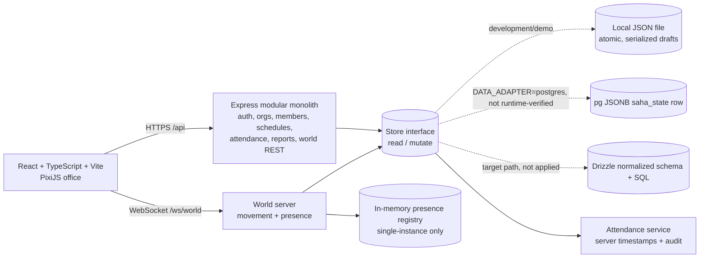

# Saha — Virtual Office SaaS (MVP)

Saha is a multi-tenant virtual office for teams, mentors and learners. It combines a navigable 2D office (PixiJS) with **server-verified attendance**, schedules, roles, invitations, reports, meetings, messaging, billing-ready entitlements and a platform-admin surface. It is a working local product, not a production deployment.

## Honest status at a glance

- **Implemented and locally verified:** phone/password auth, organizations, workspaces/rooms, members/teams and server-side RBAC, invitations and scoped access links with a guest waiting room, schedules, attendance events, reports and CSV export, the 2D PixiJS office with server-authoritative movement and presence, meeting lifecycle/controls, recording state, Drive adapter flow, webhook verification/idempotency, plans/subscriptions/quotas, analytics, messaging, notifications, local AI summaries, customization and platform admin.
- **Data storage today:** the default is a **local JSON-file repository** (`apps/api/src/common/store.ts`) with serialized transactional drafts and atomic replacement. It is **not PostgreSQL**. A PostgreSQL adapter and Drizzle artifacts exist but were never runtime-verified because no database, `DATABASE_URL`, `psql` or Docker was available. No migration, RLS policy or restore drill was executed. See [docs/database.md](docs/database.md).
- **Prepared but blocked by external dependencies:** real LiveKit media, real media capture, real Google Drive OAuth/upload, real OTP delivery, real payment-provider activation, Supabase Postgres/Storage, staging and production deployment. Local adapters return explicit `PROVIDER_NOT_CONFIGURED`, `NO_MEDIA_SOURCE` or `skipped` states instead of fabricating success. See [docs/stage2-3-completion.md](docs/stage2-3-completion.md) and the [final completion matrix](docs/FINAL_COMPLETION_MATRIX.md).

## Stack

| Layer | Choice |
| --- | --- |
| API | Node.js + TypeScript + Express (modular monolith) |
| Web | React + TypeScript + Vite, PixiJS for the 2D floor |
| Real-time | WebSocket world server on the same Node HTTP server |
| Persistence | Local JSON adapter now; PostgreSQL + Drizzle adapter/artifacts exist but are not runtime-verified |
| Validation / tests | Zod, Vitest |

Source requirements: `SRS &MASTAR.docx` / `SRS &MASTAR.pdf`. Conflict resolution and deviations are recorded in [docs/decisions.md](docs/decisions.md).

## Quick start (PowerShell)

PowerShell blocks `npm.ps1`; use `npm.cmd` (and `npx.cmd`) throughout.

```powershell
cd D:\virtual-office-saas
npm.cmd install
# Only if esbuild postinstall scripts were blocked by your policy:
npm.cmd approve-scripts --allow-scripts-pending

# Optional: create the isolated demo organization up front
npm.cmd run seed:demo

npm.cmd run dev
```

- API + world server: <http://localhost:4000> (health: `GET /api/health`)
- Web app: <http://localhost:5173> — Vite proxies `/api` and `/ws` to port 4000.
- The demo can also be created from the landing page (**Explore the demo**).

**Demo logins:** organization admin `+201000000001` / `Demo1234!` (isolated org with `settings.demo=true`); platform super admin `+201000000009` / `Demo1234!` (no org membership by design); seeded members `+201000000002`…`+201000000008` use `Demo1234!`. Sample data only; never mixed with real customer data.

To run the built app instead of the dev servers:

```powershell
npm.cmd run build
npm.cmd start   # serves dist/web and the API on PORT (default 4000)
```

## Scripts

| Command | Purpose |
| --- | --- |
| `npm.cmd run dev` | Run API and web together (`concurrently`). |
| `npm.cmd run dev:api` | API + world server only (`tsx watch`). |
| `npm.cmd run dev:web` | Vite dev server only (port 5173). |
| `npm.cmd run build` | Type-check/compile API (`tsc`) and build web (`vite build`). |
| `npm.cmd start` | Run the compiled API and serve `dist/web`. |
| `npm.cmd test` | Run the Vitest suite once. |
| `npm.cmd run test:watch` | Watch mode. |
| `npm.cmd run lint` | Type-check API and web with `tsc --noEmit`. |
| `npm.cmd run seed:demo` | Seed or reuse the isolated demo organization. |

## Architecture



Key boundaries: `requireOrg` enforces tenant scope, `requirePermission` enforces server-side RBAC, all attendance timestamps are generated on the server, and the world server validates every movement. See [docs/security.md](docs/security.md) and [docs/api-contracts.md](docs/api-contracts.md).

## Verification

```powershell
npm.cmd run lint
npm.cmd run build
npm.cmd test
```

The latest verification passed: `npm.cmd run lint`, `npm.cmd run build`, and `npm.cmd test` (**28 test files / 135 tests**; log `saha-test-final3.log`). Browser checks covered the landing, login, app shell and every new page; CDP responsive/RTL checks, a WebSocket runtime script, plan CRUD/annual/feature-gate tests and durable attendance-job tests also passed. These exercise only local adapter/in-memory paths. No PostgreSQL/psql/docker was available, so no database migration was executed. See the [final acceptance report](docs/acceptance-report.md), [stage 2/3 completion record](docs/stage2-3-completion.md), [final completion matrix](docs/FINAL_COMPLETION_MATRIX.md) and [docs/test-plan.md](docs/test-plan.md).

## Documentation

- [Implementation status](docs/implementation-status.md)
- [Final acceptance report](docs/acceptance-report.md)
- [Final Arabic 19-point report](docs/FINAL_ARABIC_REPORT.md)
- [Final completion matrix](docs/FINAL_COMPLETION_MATRIX.md)
- [Stage 2/3 completion record](docs/stage2-3-completion.md)
- [Decision log (ADRs)](docs/decisions.md)
- [Database intent and adapter boundary](docs/database.md)
- [API contracts](docs/api-contracts.md)
- [Security](docs/security.md)
- [Test plan](docs/test-plan.md)
- [Design system](docs/design-system.md)
- [Deferred register](docs/deferred-register.md)
- [Deployment](docs/deployment.md)
