# Architecture (current runtime and target path)

**Status:** current runtime is **Implemented and Verified** for local/demo flows; the Postgres JSONB adapter and normalized schema are **Implemented but Not Runtime-Verified**; normalized repository wiring is **Not Implemented**; media/Drive are **Explicitly Deferred** by recorded user directive.

The product is a modular monolith: React + Vite + PixiJS web client, Express API + WebSocket world server in one Node process, and a `Store` interface that is JSON-file-backed by default. PostgreSQL is used, when selected, as a single transactional JSONB document (`saha_state`) — not yet as normalized tables.

```mermaid
flowchart LR
  Browser[Browser: React + Vite + PixiJS] -->|HTTPS /api JSON| WebProxy[Reverse proxy: TLS, CORS, /ws upgrade]
  Browser -->|WS /ws/world token| WebProxy
  WebProxy --> Express[Express app: createApp]

  subgraph API[One Node process - single instance per ADR-002]
    Express --> Middleware[attachUser + requireOrg + requirePermission + csrfGuard]
    Middleware --> Modules[auth, orgs, workspaces, members, invitations, schedules, attendance, reports]
    Express --> World[WorldRegistry in memory: presence and movement, never persisted]
    World -->|heartbeat / join / leave| Modules
    Modules --> Store[Store interface: read + mutate]
  end

  Store -->|DATA_ADAPTER=local default| Local[JSON file: LOCAL_DATA_FILE atomic rename]
  Store -->|DATA_ADAPTER=postgres| PgStore[postgres-store.ts: SELECT FOR UPDATE in one tx]
  PgStore --> StateRow[(saha_state: one JSONB compatibility row)]

  Schema[(apps/api/src/db/schema.ts + migrations)] -.->|target path, NOT wired| Store
  StateRow -.->|future backfill; not applied| Schema

  Modules --> Audit[audit_logs in current state: planned normalized table]
  Schema --> RLS[(tenant_id + planned RLS: Not Implemented)]
  Schema --> Files[(file_assets metadata only)]
  Files -.-> Objects[(object storage: Explicitly Deferred)]

  Media[LiveKit / proximity audio / meetings / Drive] -.->|Explicitly Deferred by user directive| Browser
```

## Boundaries

- **Tenant boundary:** `requireOrg` resolves `:orgId` (or `x-organization-id`), checks active membership/guest scoping, and every lookup is filtered by `organizationId`. The UI `can()` helper is not a security boundary.
- **Write boundary:** `Store.mutate()` is the only write path today. Local adapter serializes writes; Postgres adapter locks `saha_state` with `SELECT ... FOR UPDATE`. Normalized per-row SQL transactions are a future repository concern.
- **Presence boundary:** `WorldRegistry` is in memory only (ADR-002). Multiple instances are unsupported; sticky sessions alone do not fix it.
- **Evidence boundary:** attendance timestamps are server-generated; browser presence is not attendance.
- **Deferred boundary:** media, Drive, billing, DMs and custom avatars have placeholders/notes only — no fake controls.

See [database.md](database.md), [database/erd.md](database/erd.md), [security/threat-model.md](security/threat-model.md) and [operations/runbook.md](operations/runbook.md).
