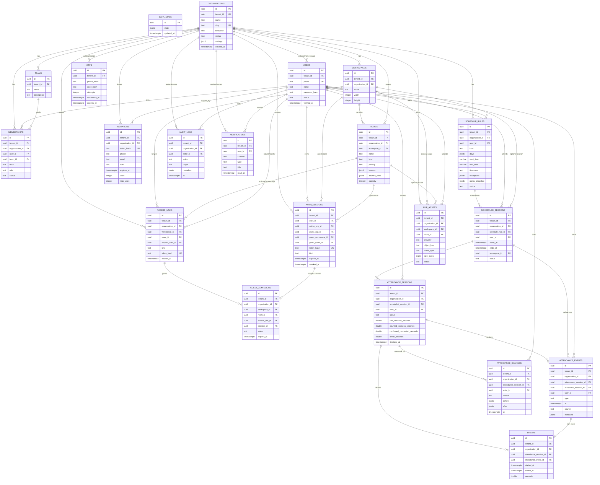

# Entity relationship diagram (target normalized schema)

> **Status: Implemented but Not Runtime-Verified.** This ERD mirrors `apps/api/src/db/schema.ts` and `apps/api/migrations/0000_initial_schema.sql`. It is a migration target, not active runtime code. Presence is intentionally absent (ADR-002). `saha_state` is a standalone JSONB compatibility row used by the active adapter.

